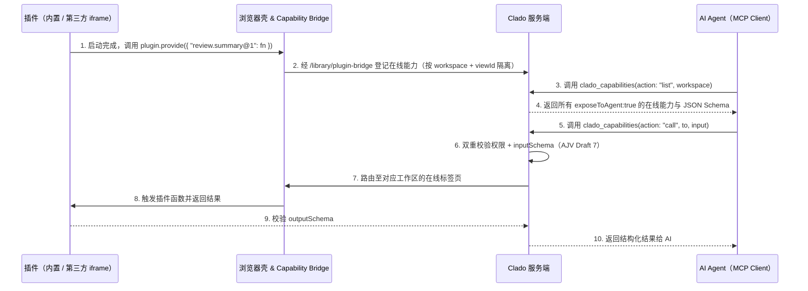

# Streamable HTTP MCP 协议

`clado serve` 在同一个本机端口同时提供浏览器只读画布与标准 **Streamable HTTP MCP** 服务：

- **实时画布**：`http://127.0.0.1:4317/`
- **MCP 端点**：`http://127.0.0.1:4317/mcp`

## 8 个高内聚核心 MCP 工具

Clado 不把上百个零散工具直接塞进模型上下文，而是收束为 **8 个高内聚、带版本乐观锁与事务回滚的核心工具**：

| 工具名 | 核心动作（`action`） | 典型用途 |
| --- | --- | --- |
| **`clado_workspace`** | `init` / `inspect` / `workspaces` / `search` / `validate` / `selection` | 初始化工作区、列举子工作区、全文搜索、全量校验、**读取用户在画布上点选的卡片（`selection`）** |
| **`clado_templates`** | `list` / `read` / `create` / `update` / `delete` / `pull` / `push` | 管理项目模板与本机用户模板库，支持继承合并与双向同步 |
| **`clado_documents`** | `list` / `read` / `create` / `copy` / `update` / `rename` / `delete` | 标准 `.md` 文档级操作；支持 `summary`/`nodes`/`source`/`full` 分级读取；重命名自动重写引用（保留 `#tagId`） |
| **`clado_nodes`** | `read` / `query` / `create` / `insert` / `update` / `rename` / `move` / `delete` | 按标题路径定位节点；支持上下游图查询（`parent`/`children`/`upstream`/`downstream`）与按唯一原文局部替换 |
| **`clado_links`** | `list` / `connect` / `disconnect` | 从具体正文行、代码行、表格行或 Mermaid 节点建立与断开连线 |
| **`clado_batch`** | `operations`（1–100 步） | 事务化批量执行混合操作，支持 `dryRun: true` 预演，任一步校验失败整批回滚 |
| **`clado_capabilities`** | `list` / `call` | 动态发现并调用所有在线插件注册的声明式能力 |
| **`clado_screenshot`** | 直接调用（`mode`/`scope`/`source`/`viewId`） | 获取当前画布实机渲染 PNG 截图 |

## 核心亮点：插件能力的动态 MCP 挂载

插件开发者**无需修改服务端 MCP 代码**，只需在 `clado-plugin.json` 中声明能力的 `inputSchema` / `outputSchema` 并开启 `exposeToAgent: true`，安装启用后即可自动进入 `clado_capabilities` 路由表：



## 客户端配置示例

在支持 Streamable HTTP MCP 的 AI 客户端（如 ZCode、Claude Code、Cursor 等）中添加：

```json
{
  "mcpServers": {
    "clado": {
      "url": "http://127.0.0.1:4317/mcp"
    }
  }
}
```

::: tip 多子工作区必填 `workspace`
每次工具调用都需传入目标工作区的绝对路径 `workspace`（必须位于 `clado serve` 启动目录内）。配合 `clado install <项目> --to <客户端>` 安装的 `SKILL.md`，AI 会自动掌握调用规范与自纠闭环。
:::
