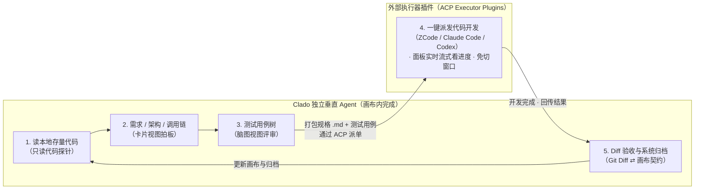

# 系统级内置 Agent 与 ACP 派单

Clado 不止是一个被外部 AI 调用的被动 MCP 画布——它还内置了面向**研发设计 / 架构走查 / 测试用例 / 变更验收**的系统级垂直 Agent（`clado.agent`），并支持通过 **ACP（Agent Client Protocol）** 把开发任务一键派发给外部 Coding Agent。

## 端到端研发协作闭环



## 原生双协议流式引擎

点击画布右下角 **「灵感」** 即可打开对话面板（移动端自动转为全宽 Bottom Sheet），内置引擎支持：

- **OpenAI 兼容 & Anthropic 原生双协议真 Token 流式输出**：支持自定义 `baseUrl`、`apiKey`、`model`，自动启用 Anthropic Prompt Caching 与可折叠的「思考过程」实时渲染。
- **4 种工作模式 + 3 套内置人设**：
  - `架构设计`（研发架构师）：先用只读探针查本地代码，再按模板画调用链与数据契约；
  - `测试用例`（QA 测试专家）：优先结合 `test-cases` 模板生成脑图测试用例树；
  - `Diff 验收`（验收审计官）：读取本地真实 `git diff` 逐项比对设计契约与遗漏点；
  - `派发开发`（ACP 执行器）：把拍板的画布规格与测试用例直接派发给外部 Coding Agent 执行。
- **持久化多会话与上下文压缩**：对话自动保存在 `.clado/sessions/`，支持在面板顶部「历史」抽屉中随时切换、删除或恢复挂起的待确认会话。

## 本地只读代码探针（拒绝编造）

内置 Agent 配备 4 个严格只读的本地仓库探针（自动尊重 `.gitignore` 并拒绝越界访问）：

| 探针工具 | 作用 |
| --- | --- |
| `probe_tree` | 扫描项目目录树与分层结构（Controller / Service / Repository / Test） |
| `probe_search` | 基于正则检索真实类名、方法名、符号与调用点 |
| `probe_read` | 按行号区间精准读取源码片段，与画布代码卡片保持一致 |
| `probe_git_diff` | 读取真实 `git status` 与 `git diff`，支撑老需求影响面分析与开发后验收 |

## 配置文件说明

在 `~/.clado/inspiration.json` 中可配置原生 LLM 与外部 ACP 执行器：

```json
{
  "engine": "builtin",
  "provider": "anthropic",
  "model": "claude-sonnet-4-20250514",
  "apiKey": "sk-...",
  "executors": [
    { "id": "zcode", "name": "ZCode", "command": "zcode", "args": ["--acp"] }
  ]
}
```

::: tip 无感回退
若未配置原生 LLM API Key，灵感面板会自动回退为本地 ACP 直连模式（默认预设 ZCode），开箱即用。
:::
