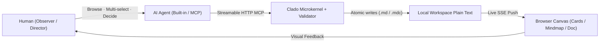

# What is Clado?

**Clado** (`cladogram` on npm) is a Markdown visual canvas, Streamable HTTP MCP server, and vertical engineering Agent platform designed around **human-in-the-loop AI software design**.

## Core Philosophy: AI Operates, Humans Observe & Direct

Traditional whiteboards force humans to drag boxes and redraw arrows manually—making diagrams rot as soon as code evolves. Clado flips the interaction model:

1. **Humans observe, review, and decide**: Explore your system interactively in **Cards** (call chains), **Mindmap** (test suites & scope), or **Document** (linear reading). Multi-select cards with `Cmd / Ctrl + Click` and tell AI what to refine.
2. **AI reads real code and maintains the canvas**: Both the built-in vertical Agent and external clients (ZCode, Claude Code, Cursor, Codex) use **Streamable HTTP MCP** to inspect your selection, obey template constraints, and apply atomic updates.
3. **Plain Markdown is the Single Source of Truth**: Every card, hierarchy level, semantic Tag, and precision wire lives in standard `.md` (with permanent `.mdc` compatibility)—readable on GitHub, VS Code, or Obsidian with zero proprietary binary lock-in.

## End-to-End Engineering Workflow

| Stage | Best View | How Clado Helps |
| --- | --- | --- |
| **1. Codebase Discovery** | Cards | Built-in read-only local probes (tree, symbol search, ranged read, Git diff) verify real classes and methods before designing. |
| **2. Architecture & Design** | Cards (Default) | Generate call-chain, data-design, and business-flow canvases using official templates and 6-color semantic Tag anchors. |
| **3. Test Case Review** | Mindmap | Structure normal, boundary, and failure test trees with the `test-cases` template and refine selected branches. |
| **4. Coding Dispatch** | Built-in Agent (ACP) | Dispatch approved `.md` specs and test trees to external coding agents (ZCode / Claude Code / Codex) directly inside the panel. |
| **5. Diff Audit & Delivery** | Cards + Doc | Verify real `git diff` against canvas contracts, update system-state archives, or export a self-contained offline HTML via `clado build`. |
