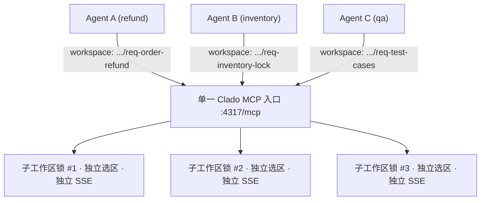

# 多子工作区并发协作

在实际研发中，往往会在同一个总目录下同时推进多个需求或模块，并让多个 AI Agent 各自负责一个子目录。Clado 原生支持**单一 `clado serve` 实例承载多个隔离的子工作区**。

## 单工作区 vs 大目录多子工作区

### 模式 A：单项目工作区

在单个项目根目录启动，所有 `.md` / `.mdc` 位于 `<项目>/.clado/doc/`：

```bash
clado serve /projects/order-service
```

### 模式 B：大目录启动，多子工作区并发

在一个父目录下启动一次 `clado serve`：

```text
/projects/requirements/               ← 在这里启动一次 clado serve
├── req-order-refund/                 ← Agent A 的独立子工作区
│   └── .clado/doc/refund-flow.md
├── req-inventory-lock/               ← Agent B 的独立子工作区
│   └── .clado/doc/lock-design.md
└── req-test-cases/                   ← Agent C 的独立子工作区
    └── .clado/doc/qa-cases.md
```

启动命令完全一致：

```bash
clado serve /projects/requirements
```

## 并发隔离与安全边界



- **路径边界保护**：每次 MCP 请求传入的 `workspace` 必须位于 `clado serve` 启动目录之内（含自身或任意子目录），越界路径一律拒绝。
- **零阻塞并行写盘**：每个子工作区维护**独立的写锁、版本号、画布选区、插件能力表与截图路由**。Agent A 修改 `req-order-refund` 时，Agent B 同时修改 `req-inventory-lock` 互不阻塞、绝不串台。
- **浏览器多工作区切换**：点击画布左下角「文档」胶囊，即可在顶部直接切换当前子工作区，或点击右侧图标在**新标签页**同时打开多个子工作区并排对照。

::: tip 按需懒初始化
当新 Agent 首次对尚未创建 `.clado/` 的子目录发起 MCP 请求（如 `clado_workspace init` 或 `clado_documents create`）时，服务端会自动初始化该子工作区并立即出现在浏览器切换列表中，无需重启 `clado serve`。
:::
