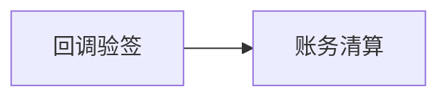

# 统一语义 Tag 与精准连线

为了让正文、列表、表格、代码块和 Mermaid 图都能用**同一套极简语法**承接精准连线，Clado 提供了 **「卡片 + 语义 Tag」二元连线模型**：

- **目标只有两种**：连到某张 **卡片 / 小节**（`[说明](#支付网关)`），或者连到文档内任意一个 **唯一 Tag ID**（`[触发验签](#verify-sign)`）。


## 1. 六色语义约定

颜色含义在模板与文档中统一约定，用低饱和微彩在不打扰单色画布的前提下快速传达语义：

| 颜色类 / 别名 | 胶囊效果 | 无字圆点 | 约定语义 | 典型场景 |
| --- | --- | :---: | --- | --- |
| `.green` / `.add` | <span class="demo-tag green">新增</span> | <span class="demo-dot green"></span> | **新增** | 新接口、新字段、新逻辑分支（兼容模板 `🟩 新增`） |
| `.amber` / `.mod` | <span class="demo-tag amber">修改</span> | <span class="demo-dot amber"></span> | **修改 / 注意** | 存量逻辑调整、兼容注意项、告警点（兼容模板 `🟨 修改`） |
| `.red` / `.del` | <span class="demo-tag red">删除</span> | <span class="demo-dot red"></span> | **删除 / 风险** | 下线代码、废弃字段、高危风险提示（兼容模板 `🟥 删除`） |
| `.blue` / `.spec` | <span class="demo-tag blue">需求原文</span> | <span class="demo-dot blue"></span> | **需求 / 契约** | 需求原文、输入输出契约、核心主流程（兼容模板 `🟦 需求原文`） |
| `.purple` / `.note` | <span class="demo-tag purple">特别说明</span> | <span class="demo-dot purple"></span> | **特别说明** | 补充约束、异步回调、降级策略（兼容模板 `🟪 特别说明`） |
| `.gray`（默认） | <span class="demo-tag gray">锚点</span> | <span class="demo-dot gray"></span> | **通用锚点** | 无特定颜色语义的纯定位锚点 |

## 2. 两种形态与跨组件写法（视觉一律归左）

因为 Tag 是被连线的落点锚点，无论作者将无字圆点写在行首、行中还是行尾，Clado 渲染时都会**自动归位到该行最左侧**，优雅承接入线。

### ① 正文 / 列表 / 表格中的 Tag

```markdown
- [需求原文]{#req-entry .blue} 参数校验后 [触发回调验签](#verify-sign)
- [新增]{#entry-idemp .green} 补齐幂等请求号校验
- 回调接口强制校验商户签名 []{#cb-verify .amber}
- []{#idempotency .green} 幂等更新账户余额并生成对账流水
```

- **有文字**（`[新增]{#id .green}` 或仅做展示的 `[新增]{.green}`）：渲染为低饱和柔和胶囊。
- **无文字**（`[]{#id .amber}`）：渲染为极简 **`5.5px` 纯色小圆点**（零多余外圈），在无序列表中直接替代灰色圆点，安静自然。

### ② 代码块中的 Tag（保持代码 100% 可直接复制编译）

在代码行尾用当前语言的注释写出 `{#id .color [可选短字]}`，支持 `//`、`#`、`--`、`/* ... */`、`<!-- ... -->`：

```ts
export async function onCallback(req: CallbackReq) {
  verifySign(req); // {#verify-sign .blue}
  return ledger.commit(req); // {#commit-ledger .green 落账}
}
```

- 源码里它是合法注释，**复制出来可以直接编译运行**；
- 画布渲染时自动剥离行尾 `{#...}` 注释文本，并将极小圆点或胶囊精准渲染在**该代码行的最左侧边槽**，入线直接落到这一行左侧！

### ③ Mermaid 图中的 Tag

在 Mermaid 代码块内使用标准注释声明节点锚点：



## 3. 连线引用语法（同文档 & 跨文档）

| 写法 | 目标类型 | 画布与引用表现 |
| --- | --- | --- |
| `[显示文字](目标卡片标题)` | 卡片 | 自左向右生成主调用实线与展开端口 |
| `[显示文字](目标卡片#小节标题)` | 卡内 L2–L6 小节 | 虚线精准落到目标小节标题左侧 |
| `[触发验签](#verify-sign)` | 同文档唯一 Tag | 精准落到目标卡内对应正文行 / 代码行左侧边槽 / Mermaid 节点，点击高亮闪烁 |
| `[触发验签](支付网关#verify-sign)` | 指定卡片内 Tag | 与 `#verify-sign` 等价，语义更显式 |
| `[幂等落账](ledger.md#idempotency)` | 跨文档 Tag | 点击跨文档跳转；经 MCP 重命名或移动文件时自动保留 `#idempotency` |

::: warning Tag ID 文档内必须唯一
如果同一份文档内定义了两个相同的 `#id`，Clado 解析器会立即报 `MD_TAG_DUPLICATE_ID` 错误，并在画布右上角诊断面板与 MCP 响应中指出精确行号。
:::

## 4. 兼容既有对称「行连行」语法（`clado:code:` / `clado:to:`）

在既有文档中，通过标准 Markdown 链接 `title` 表达的代码行 / 表格行 / Mermaid 起点与对称落点依然 100% 兼容：

```markdown
- 正文行 → 目标正文行：[触发入账](<账务清算> "clado:to:line:幂等更新账户余额")
- 正文行 → 目标代码行：[回调验签](<支付网关> "clado:to:code:1:2:verifySign")
- 代码行 → 目标代码行：[dispatch](<支付网关> "clado:code:2;text:dispatch;to:code:1:2:verifySign")
- 表格行 → 目标 Mermaid：[status](<账务清算> "clado:table:1;to:mermaid:1:SETTLE")
```

::: tip 选型建议
新编写的文档推荐优先使用 **卡片 + 语义 Tag（`#tagId`）**，写法更短、跨正文/代码/表格/Mermaid 体验完全统一，且不受行号增删漂移影响。
:::
